<div align="center">

# Omnesight
### Autonomous Operational Intelligence & Decision Infrastructure for Mission-Critical Enterprise Systems

[](https://omnesight.com)
[](https://omnesight.com/security)
[-6366f1?style=for-the-badge)](https://omnesight.com/what-is-omnesight)
[](https://omnesight.com/security)

<br/>

**[Website](https://omnesight.com)** • **[System Architecture](https://omnesight.com/what-is-omnesight)** • **[Security Core](https://omnesight.com/security)** • **[Executive Briefing](https://omnesight.com/contact)**

</div>

---

### Executive Overview

**Omnesight** is the sovereign operational intelligence infrastructure deployed above enterprise systems of record. We bridge enterprise ERPs (**SAP S/4HANA**, **Oracle NetSuite**, **Microsoft Dynamics 365**), industrial **SCADA/IoT telemetry**, and financial ledgers to autonomously detect capital leakage, reconcile multi-entity balance sheets, and execute policy-constrained remediations.

Instead of passive retrospective reporting, Omnesight deploys a closed-loop execution engine: continuously ingesting transactional events, diagnosing causal root-causes in real time, and executing supervised write-backs under verifiable human executive governance.

---

### Architectural Topology

```mermaid
flowchart LR
    subgraph Ingestion ["1. Distributed Ingestion Layer"]
        ERP["Enterprise ERPs\n(SAP S/4HANA • NetSuite • Dynamics)"]
        SCADA["Industrial Telemetry\n(SCADA • Sensor Bus • MQTT)"]
        FIN["Financial Ledgers\n(Multi-Entity Cash • Gateways)"]
    end

    subgraph Engine ["2. Sovereign Cognitive Engine"]
        NORM["Deterministic Normalization\n& Schema Alignment"]
        CAUSAL["Causal Memory & Anomaly Detection\n(EBITDA & Margin Leakage Engine)"]
        POLICY["Policy Verification Matrix\n(Zero-Trust Boundary)"]
    end

    subgraph Action ["3. Supervised Execution Layer"]
        HITL["Supervised Action Protocol\n(Dual-Key Cryptographic Sign-Off)"]
        WRITE["Guaranteed ERP Write-Back\n(Instant Rollback • Immutable Audit)"]
    end

    Ingestion --> NORM --> CAUSAL --> POLICY --> HITL --> WRITE
```



---

### Core Engineering Capabilities

* **Continuous Ledger & Telemetry Synchronization :** Real-time entity resolution and balance-sheet reconciliation across disparate subsidiaries, warehouse hubs, and transit corridors without disruptive core ERP migrations.
* **Deterministic Anomaly & Margin Leakage Engine :** Root-cause causal models pre-empting unmonitored inventory shrinkage, supplier contract penalty oversights, and currency mismatch risks.
* **Supervised Action Protocol (Human-in-the-Loop) :** Zero unverified writes. High-impact operational mutations (dispute holds, buffer replenishment, purchase orders) operate through cryptographic multi-tier authorization with instant one-click rollback capabilities.
* **Total Data Sovereignty & Zero-Training Guarantee :** Single-tenant VPC (AWS/Azure/GCP) or air-gapped on-premise deployment. Zero enterprise data is ever exposed to public LLMs or used for cross-tenant model training.

---

### Technology Stack & Infrastructure Standards

```text
├── Ingestion & Streaming    :: Apache Kafka, Redis, WebSockets, MQTT Gateways
├── Backend Core & Agents    :: Python 3.12+, FastAPI, Celery, TypeScript, NestJS
├── Deterministic Analytics  :: PyTorch, Causal Inference, Statistical Anomaly Scoring
├── Datastores & State       :: PostgreSQL, pgvector, Redis Cluster, Temporal
├── Enterprise UI Layer      :: Angular 20+, TailwindCSS, High-Performance Canvas
├── Security & Cryptography  :: Customer-Managed KMS (AES-256), TLS 1.3 mTLS, SOC 2 Type II
└── Deployment Boundaries    :: Kubernetes, Terraform, Single-Tenant Isolated VPC, Air-Gapped On-Prem
```

---

### Mission-Critical Deployment Benchmarks

| Metric | Enterprise Specification | Operational Benchmark |
| :--- | :--- | :--- |
| **Go-Live Deployment** | Non-invasive connector ingestion | **< 30 Days** to first anomaly discovery |
| **System Availability** | Dedicated mission-critical SLA | **99.99%** with 24/7 engineering response |
| **Data Boundary** | Sovereign client partition | **Zero external LLM training exposure** |
| **Audit Traceability** | Cryptographic forensic ledger | **100% immutable action logs with rollback** |

---

### Institutional Contact & Solutions Architecture

Omnesight engages with enterprise clients through institutional deployment frameworks, confidential proof-of-value pilots, and performance-aligned commercial partnerships.

* **Executive Briefings & Architecture Reviews :** [omnesight.com/contact](https://omnesight.com/contact)
* **Security & Vulnerability Disclosure :** [security@omnesight.com](mailto:security@omnesight.com)
* **Institutional Inquiries :** [sales@omnesight.com](mailto:sales@omnesight.com)

<br/>

<div align="center">
  <sub>© 2026 Omnesight Intelligence Layer. All architectural rights reserved.</sub>
</div>
